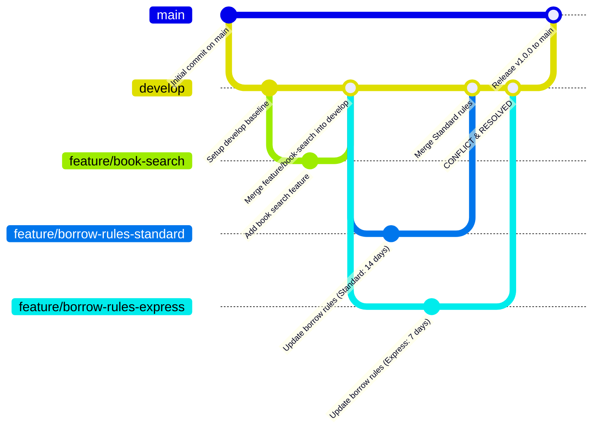

# 📚 Library Management System - ASE Lab Experiment

## 🎯 Experiment Objective
- Demonstrate **Gitflow Workflow** (`main`, `develop`, and `feature` branches).
- Execute feature development across branches and integrate into `develop`.
- Deliberately simulate a **Merge Conflict** between competing feature updates.
- Successfully detect, manually resolve, and finalize the merge conflict with complete auditability.

---

## 🌿 Gitflow Architecture



---

## 🚀 Branching Hierarchy
1. **`main`**: Production-ready, stable releases.
2. **`develop`**: Central integration branch for ongoing features.
3. **`feature/book-search`**: Added search capability by Title / Author.
4. **`feature/borrow-rules-standard`**: Configured standard 14-day loan rules with late fine Rs. 5/day.
5. **`feature/borrow-rules-express`**: Configured express 7-day loan rules with late fine Rs. 10/day (Conflicting modification).

---

## ⚡ Step-by-Step Execution Log

### 1. Repository Setup & Base Commits
```bash
git init
git checkout -b main
# Created library.py base
git add .
git commit -m "feat: initial commit - core library management system"
git branch -M main
git push -u origin main
```

### 2. Initialize `develop` Branch
```bash
git checkout -b develop
git push -u origin develop
```

### 3. Feature Branch 1 (`feature/book-search`)
```bash
git checkout -b feature/book-search
# Implemented search_books() function
git commit -am "feat: implement book search by query"
git checkout develop
git merge --no-ff feature/book-search -m "merge: feature/book-search into develop"
git push origin develop
```

### 4. Simulating Merge Conflict
Two parallel branches modify the exact same method (`borrow_book` and policy settings):

- **Branch A (`feature/borrow-rules-standard`)**:
  ```python
  LOAN_PERIOD_DAYS = 14
  LATE_FEE_PER_DAY = 5
  ```
- **Branch B (`feature/borrow-rules-express`)**:
  ```python
  LOAN_PERIOD_DAYS = 7
  LATE_FEE_PER_DAY = 10
  ```

Merge Sequence:
```bash
# Merge Branch A into develop (succeeds cleanly)
git checkout develop
git merge feature/borrow-rules-standard

# Merge Branch B into develop (TRIGGERS CONFLICT!)
git merge feature/borrow-rules-express
# CONFLICT (content): Merge conflict in library.py
# Automatic merge failed; fix conflicts and then commit the result.
```

### 5. Resolving the Conflict
The conflict markers `<<<<<<< HEAD`, `=======`, and `>>>>>>>` were inspected in `library.py`:
Unified resolution combined both options into a flexible policy:
```python
# Resolved configuration:
LOAN_PERIOD_STANDARD = 14
LOAN_PERIOD_EXPRESS = 7
DEFAULT_LATE_FEE = 5
```

Finalizing merge:
```bash
git add library.py
git commit -m "fix(conflict): resolve borrow policy clash between standard and express branches"
```

### 6. Final Release to `main`
```bash
git checkout main
git merge --no-ff develop -m "release: v1.0.0 library management system with resolved borrow policies"
git push --all origin
```

---

## 💻 How to Run the Application
```bash
python library.py
```

---

## 📝 Lab Exam Summary & Findings
- **Gitflow** isolates unstable changes from production code.
- Merge conflicts arise when parallel branches modify the same lines of code.
- Resolved conflict cleanly by preserving intent from both feature requirements.
